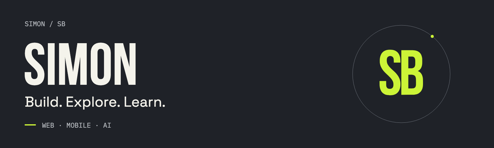

<!-- Upload README.md and assets/ together to the root of SimonBitton/SimonBitton. -->

# Simon

Passionate about software development, design, and building products people actually love.
Currently building a beach-equipment rental platform — powered by web, mobile, and a touch of AI.

[Currently building](#building) · [Interests](#interests) · [Tech stack](#stack) · [Stats](#stats) · [Contact](#contact)

---

## 01 / Currently building

### Beach Rental Platform

A modern, end-to-end platform for renting beach equipment online — from browsing gear to booking a spot on the sand in a few taps.

**Focus areas**

- **Web development** — a fast, responsive booking experience.
- **Mobile apps** — on-the-go rentals for customers and vendors.
- **Artificial intelligence** — smart recommendations and automation.
- **Cloud** — scalable infrastructure.
- **Automation** — streamlined operations behind the scenes.

---

## 02 / What I'm into

<strong>What I'm exploring</strong>

---

## 03 / Tech stack

Expand a category to explore the tools I use.

<strong>Languages</strong>

TypeScript · JavaScript · Swift · Python · HTML · CSS

<strong>Frontend</strong>

React · Next.js · Tailwind CSS · Vite

<strong>Backend</strong>

Node.js · Express · Supabase · Firebase

<strong>Databases</strong>

PostgreSQL · MySQL · MongoDB

<strong>DevOps</strong>

Docker · GitHub · Vercel · Cloudflare

<strong>Tools</strong>

VS Code · Git · GitHub · Figma · Postman

---

## 04 / GitHub stats

[View my GitHub profile](https://github.com/SimonBitton) · [Explore my repositories](https://github.com/SimonBitton?tab=repositories)

<strong>Contribution streak</strong>

### Activity

[Explore my contribution graph and recent activity on GitHub](https://github.com/SimonBitton#year-list-container).

<strong>Contribution snake</strong>

An animated contribution grid can be generated with the SB palette using the supplied GitHub Actions workflow.

[Generate or refresh the animation](https://github.com/SimonBitton/SimonBitton/actions/workflows/sb-snake.yml)

<!-- After running the included workflow once, uncomment the next line. -->
<!--  -->

---

## 05 / Let's build something great together

[Visit my portfolio](https://simon-b-one.vercel.app/)

> “Code is the closest thing we have to magic — I just try to use it well.”

<strong>Random dev quote</strong>

