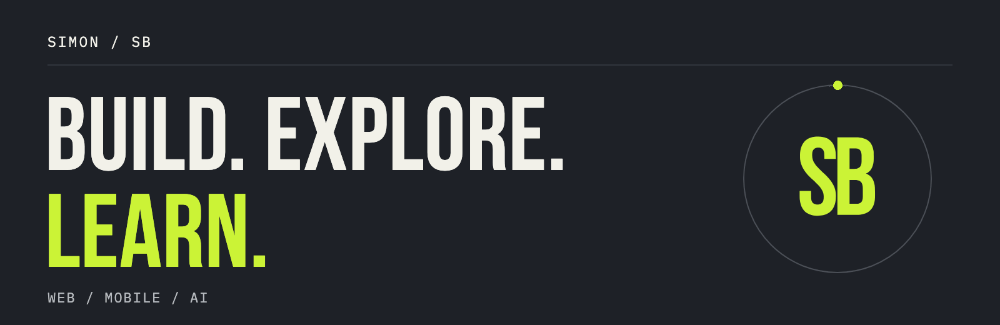

<!-- Copy README.md and assets/ together to the root of SimonBitton/SimonBitton. -->
<picture>
  <source media="(prefers-reduced-motion: reduce) and (max-width: 600px)" srcset="assets/banner-mobile.png">
  <source media="(prefers-reduced-motion: reduce)" srcset="assets/banner.png">
  <source media="(max-width: 600px)" srcset="assets/banner-mobile.gif">
  
</picture>

# Simon

I build digital products across **web, mobile and AI**, with a focus on thoughtful design and a simpler user experience.

[Building](#building) · [Stack](#stack) · [Activity](#activity)

## 01 / Currently building

### Beach Rental Platform

From choosing beach equipment to booking it in a few taps. I'm building a platform that brings the rental experience to web and mobile.

- **Web** — a fast, responsive booking experience.
- **Mobile** — rentals on the go, for customers and vendors.
- **AI & automation** — recommendations and simpler operations.

**Explore my work → [Portfolio](https://simon-b-one.vercel.app/)**

## 02 / My toolbox

| Area | Technologies |
| :--- | :--- |
| Web | TypeScript · JavaScript · React · Next.js |
| Mobile | Swift |
| Backend | Node.js · Express · Supabase · Firebase |
| Data | PostgreSQL · MySQL · MongoDB |

<strong>More languages, infrastructure & design tools</strong>

- **Languages** — Python · HTML · CSS
- **Styling & builds** — Tailwind CSS · Vite
- **Infrastructure** — Docker · Vercel · Cloudflare
- **Tools** — Git · GitHub · VS Code · Figma · Postman

**Exploring:** AI applications · UI/UX · Cloud · Automation

## 03 / In motion

Follow the work as it evolves.

**[Repositories →](https://github.com/SimonBitton?tab=repositories)** — explore the code.  
**[GitHub activity →](https://github.com/SimonBitton?tab=overview)** — see contributions and recent work.

---

**Build. Explore. Learn.**  
Simon / SB · [Visit my portfolio ↗](https://simon-b-one.vercel.app/)
